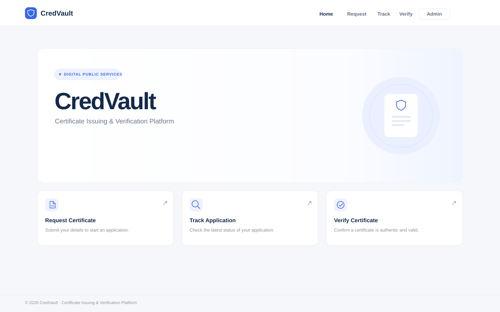
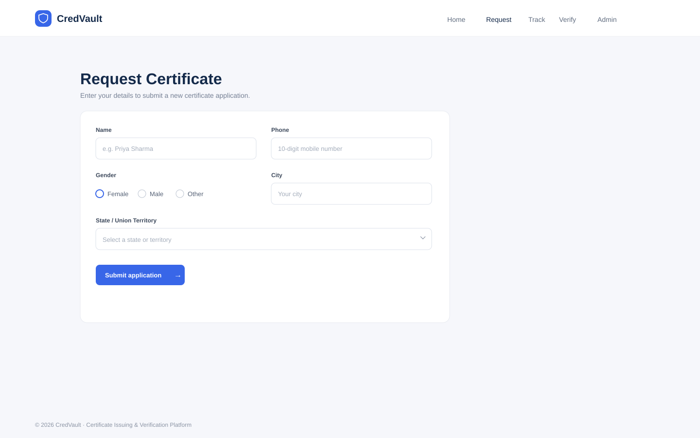
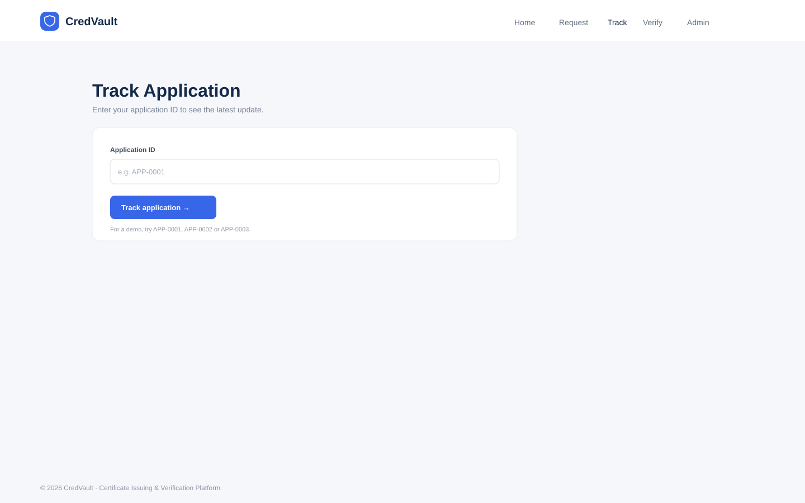
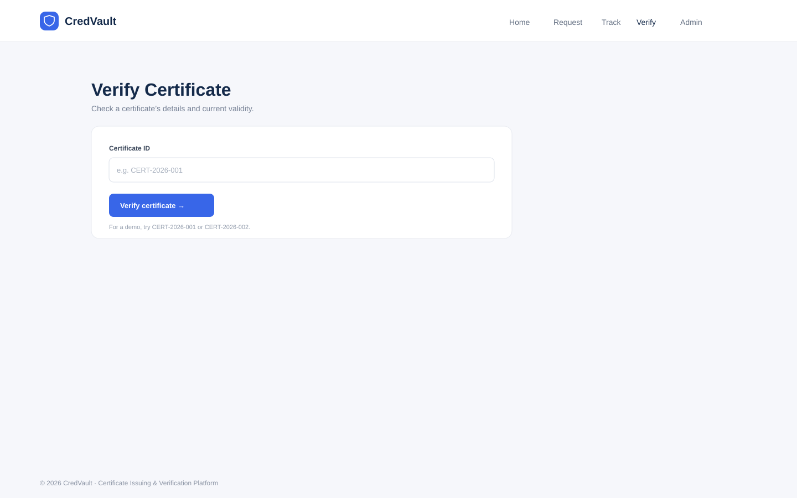
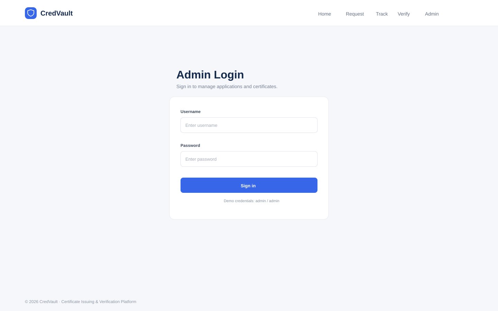
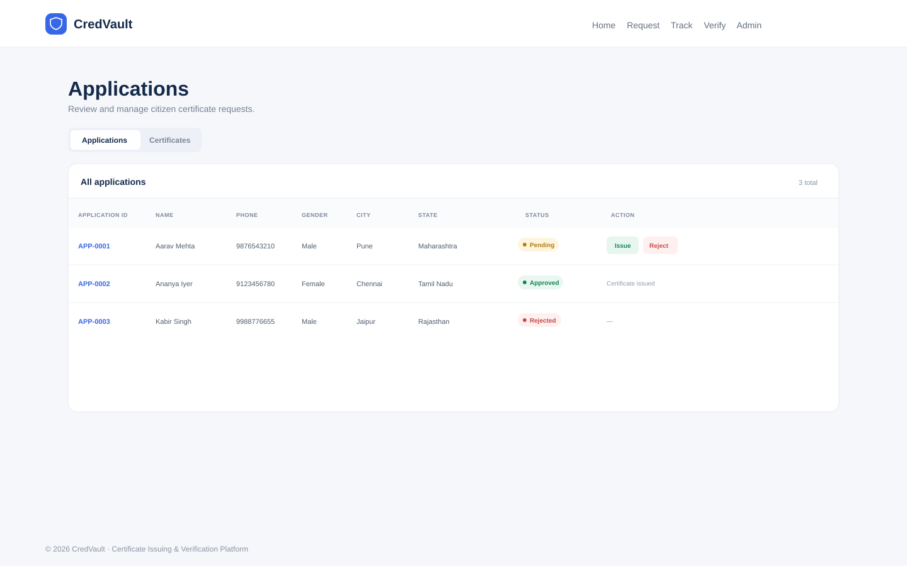
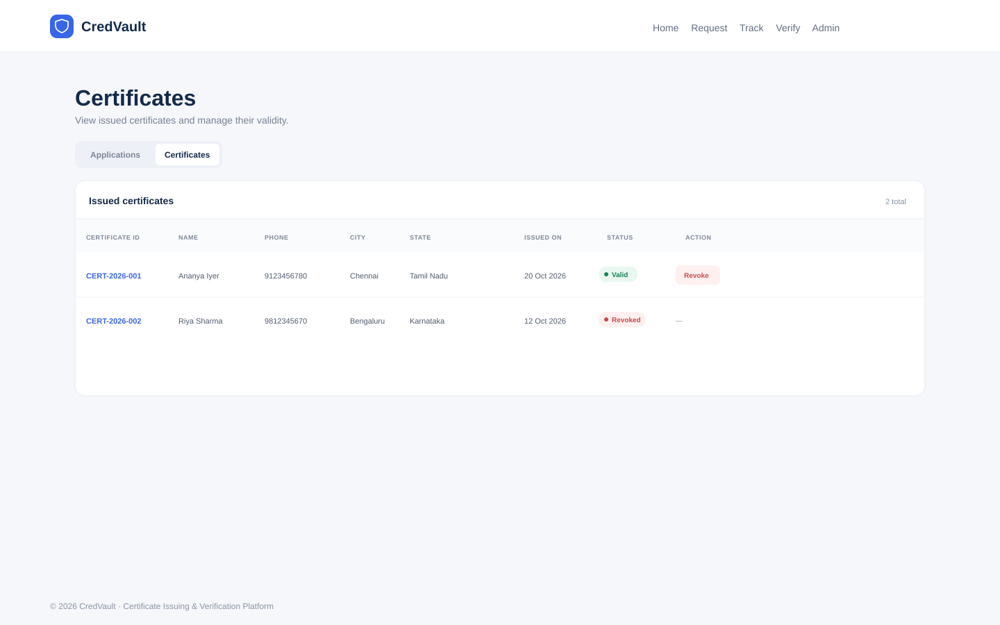

# CredVault · ELEVATE SDE Task 2

A responsive frontend prototype for a digital certificate issuing and verification platform. It is built with vanilla HTML, CSS and JavaScript, with no framework or install-time dependencies.

## Run locally

```bash
npm start
```

Open [http://localhost:4173](http://localhost:4173). The included server serves the single-page app on every route, so direct navigation and refresh work for all pages.

## Demo credentials and data

- Admin login: `admin` / `admin`
- Example application IDs: `APP-0001`, `APP-0002`, `APP-0003`
- Example certificate IDs: `CERT-2026-001`, `CERT-2026-002`
- Demo applications and certificates are saved in the browser with `localStorage`. Admin sign-in is a demo-only `sessionStorage` flag.

Submitting a request creates a new pending application. Issuing a pending application adds a valid certificate; rejecting an application and revoking a certificate update their displayed statuses. Public tracking and verification read from the same demo data.

## Screenshots

### Home



### Request Certificate



### Track Application



### Verify Certificate



### Admin Login



### Applications



### Certificates



## Routes

| Route | Purpose |
| --- | --- |
| `/` | Citizen home page and navigation |
| `/request` | Certificate request form |
| `/track` | Application status lookup |
| `/verify` | Public certificate verification |
| `/admin/login` | Demo admin login |
| `/admin/applications` | Review, issue or reject requests |
| `/admin/certificates` | Review or revoke issued certificates |

All data is dummy data for this frontend task. Connect the forms and actions to an API when adding a backend.

